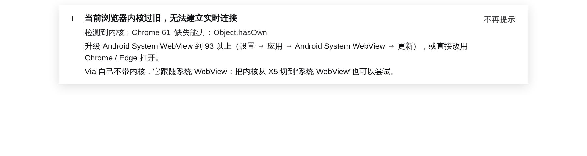

# dsh-ui-browser-compat

A DeepSeek Harness (DSH) Web client plugin that turns the **silent "Reconnecting…" loop** on an
old browser engine into a clear statement of cause and a fix.

中文说明见 [README.zh.md](README.zh.md)。

---

## The problem

The DSH Web GUI talks to its Host over a WebSocket at `/api/remote.mux`, with a 2-second server
heartbeat. Loading the page also fetches *client plugin bundles at runtime*, and those bundles are
built for a modern engine.

On an old engine — typically an **Android System WebView** behind a shell browser such as
**Via**, X5, or a stripped vendor browser — this happens:

1. The shell HTML parses and the UI mount *may* succeed, so the page does not look "broken"
2. The runtime plugin bundles fail to parse, or the WebSocket cannot hold the heartbeat
3. The connection service never comes up
4. The UI shows **"重新连接中" / "Reconnecting" forever**, with no explanation

The user has no way to know the page will never work on that device.

## What this plugin does

It probes the *running* engine and reports what it finds:

- A **frame-wide banner** (`shell.overlay`) when the engine cannot hold the live connection,
  naming the detected engine, the missing capabilities, and the exact fix
- A **General Settings row** (`settings.general.item`) that is always available, with a
  **copyable diagnostics report** for bug reports and support threads

The plugin never replaces the transport and never claims an engine is fine when the probes say
otherwise. It is a diagnostic, not a compatibility shim — see
[Bleeding edge](#bleeding-edge-why-this-cannot-make-an-old-engine-work) for why a plugin alone
cannot make the page work.

## Screenshot



## Install

This package is designed to live inside a DSH checkout at
`packages/client/ui-browser-compat/`.

```bash
# from the DSH repo root
cp -r dsh-ui-browser-compat packages/client/ui-browser-compat
```

Register the plugin in the Web app composition,
`packages/bundle/web-app/cordis.patch.yml`, inside the browser plugin roster:

```yaml
    - id: ui-browser-compat
      name: '@deepseek-ai/dsh-client-ui-browser-compat'
```

Then rebuild the client artifacts and the Web shell:

```bash
pnpm run build:lib:client
pnpm run build:web
```

Restart the `dsh web` process and reload the page.

## What is probed

| Capability | Engine floor | Why it matters |
|---|---|---|
| `Promise` | Chrome 32 | Every async path in the shell |
| `fetch` | Chrome 42 | Transport and RPC |
| `WebSocket` | Chrome 5 | The live connection itself |
| `Object.hasOwn` | **Chrome 93** | Used by the runtime plugin bundles |
| Class private fields `#x` | **Chrome 84** | Used by the runtime plugin bundles |
| Static class fields | Chrome 72 | Used by the runtime plugin bundles |
| ES module script | Chrome 61 | The whole shell |
| CSS `:has()` | Chrome 105 | Layout correctness (menu, rows) |
| CSS `color-mix()` | Chrome 111 | Theme colors |

The transport-critical subset (`WebSocket`, `fetch`, `Object.hasOwn`, class private fields,
static class fields) decides the `incompatible` verdict. CSS gaps are reported but do not
trigger the banner alone — they degrade styling rather than kill the connection.

## Writing the probe in old syntax — on purpose

This is the part that is easy to get wrong: **a diagnostic that an old engine cannot parse is
worthless.**

`src/client/probe.ts` therefore contains no `?.`, no `??`, no `??=` / `||=`, no arrow functions,
no template literals, and no `Array.prototype.includes`. Syntax that an old parser would reject
outright (class private fields, static fields) is isolated inside `eval`, so a rejecting engine
returns `false` instead of dying on the whole module.

A build gate for this is on the wish list; today it is a source convention plus a review check.

## Build

The package builds with the DSH client preset (`packages/client/tsdown.client.ts`), which emits
the `window.__ModuleLoader__.load({ id, factory })` closure-factory artifact the client module
table expects.

```bash
pnpm --filter @deepseek-ai/dsh-client-ui-browser-compat run bundle
```

`lib/` in this repository is the artifact built from `src/`. It is committed so that a reader can
inspect exactly what ships, but a real installation should rebuild it inside its checkout.

## Verification

`verify/` holds the standalone harness used during development:

- `server.mjs` serves a DSH `index.html` through the **real** index-injection pipeline, loads the
  **real** built bundle, and calls `apply` with a minimal Cordis-shaped context
- `verify.mjs` drives it with Playwright, faking an old engine by deleting modern capabilities
  and overriding the user agent

What it proves: the bundle registers under its package name, `apply` registers both slots, the
injected faces produce a verdict, the banner renders with correct interpolation, and dismissal
works. What it cannot prove: behaviour inside a real DSH Host, which needs an installation.

## Bleeding edge: why this cannot make an old engine work

A client plugin cannot fix an engine that cannot parse the product. Specifically:

- The main shell bundle is built with Vite `target: 'es2022'`
- **Every** runtime plugin bundle (including this one) is built by the client preset at
  `target: 'es2024'`
- `:has()` and `color-mix()` are not downleveled today

Truly supporting an old WebView needs a legacy build variant at the package layer: a downleveled
build target, CSS downleveling with `:has()` fallbacks, and API polyfills injected by the
document before any module runs. That is a platform change, not a plugin.

If the engine is too old for the shell itself, not even this banner can render.

## Status

Developed and verified against a DSH 0.2.1-rc.3 checkout. The probe logic, bundle build, slot
registration, banner rendering and dismissal were tested in a standalone harness. It has **not**
been exercised inside a live DSH Host, because the development environment mounted its checkout
read-only.

## License

MIT
